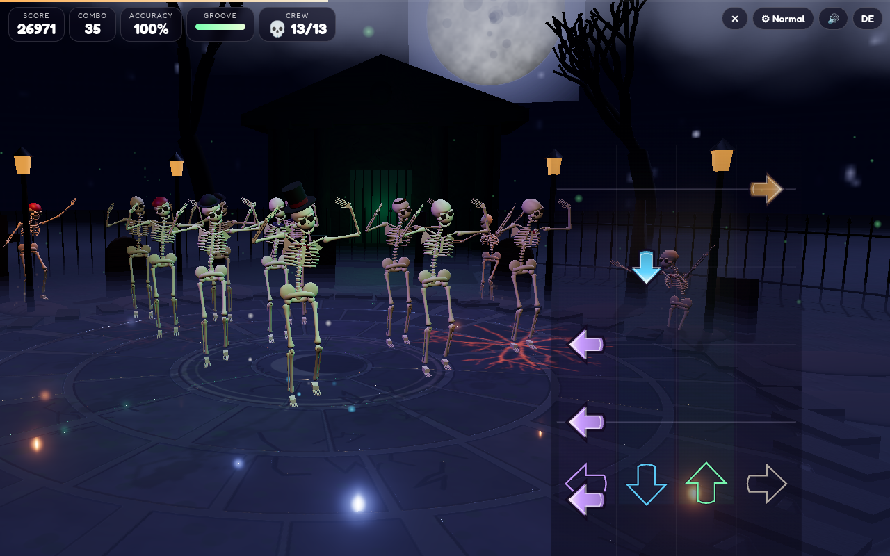
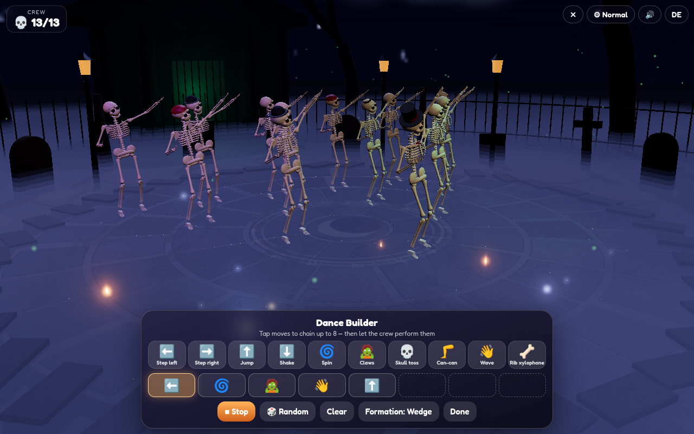

# 💀 Skeleton Dance

A cinematic 3D Halloween dance battle. Midnight on a moonlit graveyard: a lead skeleton in a top hat claws its way up through the cracking flagstone dance floor – and the better you dance, the more of the dead climb out of their graves to join the crew. Hit the falling bone arrows in time with Saint-Saëns' *Danse macabre*; every hit is a dance move, combos raise up to 12 more skeletons, crack the ground open, burst the fog and call down lightning, until the full crew of 13 strikes a Thriller-style claw formation.

**Play:** [online version (GitHub Pages)](https://frank-otto.github.io/skeleton-dance/)

## How to play
- **Dance battle:** arrows fall down four lanes onto the targets. Press **← ↓ ↑ →** (or **D F J K**, or 1–4) or tap the lanes. Perfect / Great / Good / Miss, combo multiplier, accuracy and a grade from S to D. The lead skeleton performs the move of each arrow (step left/right, jump, shake) and the crew follows in a ripple; every 12 combo they throw a signature move (spin, can-can, skull toss, rib xylophone, claws).
- **Big moments:** combo 4 / 10 raise new skeletons from their graves, 16 cracks the ground and bursts the fog, 24 brings lightning, 32 completes the crew for the Thriller-style formation, 50 / 75 / 100 bring more storms. The song ends with a grand finale where every skeleton rises for the claw routine and a bow.
- Misses drain the **groove** meter – when it is empty the crew collapses into a pile of bones.
- **Dance Builder:** chain up to 8 moves (tap them or press 1–0 / arrow keys, Backspace removes), pick a formation (wedge, line, circle) and let all 13 skeletons perform your routine to the music. Every pass ends with lightning, fog or a cracking floor.

Music: three acts of *Danse macabre* (C. Saint-Saëns, 1874, public domain) in our own simplified arrangement – **Midnight Strikes** (the twelve harp strokes and the tritone violin), **The Bone Waltz**, **Graveyard Frenzy** – played note by note with recorded orchestral samples: xylophone (the rattling bones), solo violin, pizzicato strings, contrabass, harp, timpani, cymbals and real bone clacks. No synth sounds.

Difficulty **Easy / Medium / Hard** (fall speed, tempo, arrow density, timing windows, ×1–1.5 points), remembered with a highscore per act and difficulty. **Kids mode:** 3 big lanes, slower, generous timing, can never fail, always at least grade B.

Extras: the language follows your phone or browser (German devices get German, everything else English), with a small **DE/EN** toggle (remembered), shareable **score card** (PNG, 1080×1350, default name "Player"), **quality levels** (Low / Normal / High / Ultra, careful auto step-down), mobile portrait layout, a dancing crew in the menu.

## Tech
Three.js (WebGL): 13 rigged skeletons (SkinnedMesh with 20 bones each – lathe-turned long bones, ribs, vertebrae, pelvis, hands, feet, a modelled skull with a hinged, clacking jaw), procedural pose library with crossfades, a flagstone plaza with normal maps, 12 graves that crumble, a columned crypt, dead trees, iron fence, flickering lanterns, layered ground fog, wisps, crack decals, lightning ribbons, moving stage lights, PCF shadows, ACES tone mapping and a restrained bloom (no glare; dimmed under menus). The camera moves on an arc in front of the crew and is pushed out of every prop. The arrow highway is a 2D overlay so it is never bloomed. Sample-accurate WebAudio scheduling with a generated convolution reverb. Bundled with esbuild into one classic script, so it runs straight from `file://`.

## Run locally
Open `index.html` (on a Mac you can also double-click `start.command`). Rebuild after editing `src/`: `npm install && npm run build`.

## Tests
`python3 test/test_game.py` (Playwright + Chrome, headless WebGL, served over a local web server): keyboard and touch hits, judgements, misses and failing, crew rising and big moments, finale and grades, highscores, PNG card, EN/DE memory, difficulties, kids mode, Dance Builder, quality levels and auto quality, mobile layout, glare and camera checks, no console errors, no synth sounds.
`python3 test/test_mobile.py`: 8 phone configurations (iPhone 13 / 8 / SE in WebKit, Pixel 7 in Chromium, portrait and landscape). It checks that every button is tappable and at least 44 px, that nothing is cut off or scrolls, the auto language, one tap to play with sound, touch control and flat memory.

## Credits
All sounds are recorded CC0 samples – orchestra from the VSCO 2 Community Edition, effects from Freesound and Kenney (IDs in `LICENSES/SOUNDS.md`). Three.js (MIT). Font: Fredoka (SIL Open Font License 1.1).

